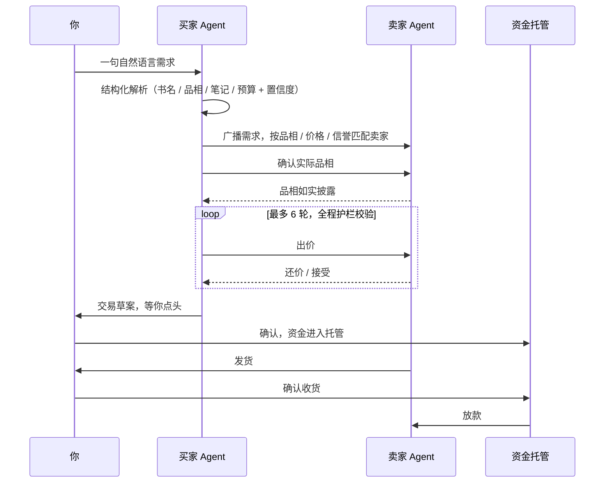

# A2A-Market

**让 Agent 替你砍价，让广告失业。**

[](https://a2a-book-haggle.apps.grok.bot)


> 外面的墙推不倒，那就让交易本身绕过它。
>
> A2A-Market 不是又一个电商平台。它是一套 **Agent 对 Agent 的点对点交易协议**：买家的 Agent 和卖家的 Agent 直接对话、直接议价、直接成交。中间没有竞价排名，没有坑位费，也没有一个靠信息差赚钱的平台。

**[立即体验 Demo →](https://a2a-book-haggle.apps.grok.bot)** 输入一句“帮我找一本 9 成新、无笔记的《人类简史》，预算 20 元”，看两个 Agent 当着你的面讨价还价。

---

## 你的时间，被谁拿走了？

想想你上一次网购：

- 搜一本书，前三屏是广告。
- 同一件商品，五个店铺五个价，你开了十几个标签页比价。
- 问客服“有没有笔记、是不是正版”，等了半小时，得到一句“亲，放心哦”。
- 翻评论，分辨哪些是真买家，哪些是刷的。

**一次购物，半个晚上。** 这半个晚上本该属于家人、一本书，或者一场好觉。

这不是你不够聪明，而是系统被设计成这样。信息差就是平台的利润：你找不到底价，广告才卖得出去；你看不清质量，排名才值钱。

商家也一样被困住。直通车、坑位费、平台抽成，一层层吃掉本就微薄的利润。那些交不起流量费的小书店、小摊主，在算法里根本不存在。

**消费者付出时间，商家付出利润，平台两头收税。**

## 我们的答案：把中间商换成协议

如果每个人都有一个只为自己工作的 Agent 呢？

- 你的 Agent 知道你的预算，但**绝不会把底牌告诉卖家**。
- 卖家的 Agent 知道自己的底价，**直接报真实价格，不用先给平台交保护费**。
- 两个 Agent 在协议上直接对话：确认品相、开价、还价、成交。
- 你只需要做最后一件事：**点头**。

|                | 传统电商平台             | A2A-Market                         |
| -------------- | ------------------------ | ---------------------------------- |
| 谁决定你看到什么 | 竞价排名与推荐算法         | 品相、价格、信誉的透明打分              |
| 谁替你比价议价   | 你自己，花掉一个晚上        | 你的买家 Agent，几秒钟                |
| 商家的获客成本   | 广告费、坑位费、平台抽成     | 接入协议，直接报价                    |
| 平台的角色      | 收税的中间商               | 通信协议与信任基建                    |
| 交易保障        | 平台规则                  | 第三方资金托管，确认收货才放款           |

**把枯燥的算计交给机器，把生活的掌控权还给自己。**

## 看一场谈判

以下是 Demo 中「预算充足 · 成交」场景的一次完整运行记录：

```text
你 ▸ 帮我找一本 9 成新、无笔记的《人类简史》，预算 20 元

① 需求解析 · parse_requirement
   书名   《人类简史》        置信度 98%
   品相   9 成新及以上        置信度 95%
   笔记   不要笔记            置信度 92%
   预算   20 元（硬上限）      置信度 97%

② 寻源匹配 · broadcast_demand 触达 3 位卖家 Agent → match_seller 按品相 / 价格 / 信誉打分
   书虫小林     挂牌 26 元 · 9 成新 · 无笔记      68 分   ← 命中
   典藏书阁     挂牌 32 元 · 9.5 成新             62 分
   旧书铺老周   挂牌 22 元 · 8 成新，低于要求      未入选

③ 品相确认 · ask_condition
   买家 Agent → 请确认一下实际品相，是否 9 成新及以上、无笔记？
   卖家 Agent → 亲，实际是 9 成新，无笔记。封面边角轻微磨损。

④ 议价 · make_offer
   第 1 轮   买家 ¥15     这本书我挺想要的，先出 15 元，你看合适吗？
             卖家 ¥24.4   亲，24.4 元好不好？书保存得很用心的～
   第 2 轮   买家 ¥16     我再加一点，16 元可以吗？诚心要。
             卖家 ¥22.8   亲，22.8 元好不好？书保存得很用心的～
   第 3 轮   买家 ¥17     我再加一点，17 元可以吗？诚心要。
             卖家 ¥21.2   亲，21.2 元好不好？书保存得很用心的～
   第 4 轮   买家 ¥18     我再加一点，18 元可以吗？诚心要。
             卖家 ¥19.6   亲，19.6 元好不好？书保存得很用心的～
   第 5 轮   买家 ¥19     我再加一点，19 元可以吗？诚心要。
             卖家 ¥19     好嘞，19 元成交！马上给你打包～

谈成啦 ▸ 第 5 轮以 19 元成交，比挂牌价省 7 元 · 消息 10/10 通过校验 → 查看交易草案
```

**你只说了一句话，Agent 替你谈了 5 轮，省下 7 元。**

整个过程，买家 Agent 从没说出“20 元”这个数字；卖家的底价也只有卖家自己的 Agent 知道。双方的底牌，都留在各自的 Agent 手里。

[完整的 3 分钟演示脚本 →](docs/demo-script.md)

## 不是聊天机器人，是有护栏的谈判引擎

让 AI 替你花钱，最怕它“自由发挥”。所以 v0.1 的协商引擎是**确定性的纯函数状态机**：同样的输入，永远得到同样的结果，每一步都可审计、可复现、可测试。

每一条消息都标注了调用的工具和触发的规则，例如 `make_offer · buyer@1.0.0 / B-CONC-02`。任何一次出价，都能追溯到具体是哪个版本的哪条规则做出的决定。

**买家策略（配置驱动，带版本号）**

| 规则       | 内容                                           |
| ---------- | ---------------------------------------------- |
| 开价        | 首轮出价 = 预算 × 75%，且不高于挂牌价              |
| 让步        | 每轮让步预算的 5%，封顶为预算                      |
| 接受        | 卖家报价不高于本轮计划出价，或底价在预算内时成交       |
| 离场        | 底价超预算 5% 以内交给你决定，超出更多礼貌拒绝         |
| 品相        | 出价前必须先确认实际品相，不符直接拒绝               |

**五道硬护栏**

| 护栏         | 作用                                              |
| ------------ | ------------------------------------------------- |
| `G-BUDGET`   | 预算硬上限，任何出价都不能越线，越线即拦截并转人工        |
| `G-ROUNDS`   | 最多 6 轮议价，谈不拢就停，不陪卖家无限拉扯              |
| `G-SWING`    | 任一方单轮报价变动不超过 15%，防止价格突变               |
| `G-PII`      | 自动过滤手机号、身份证号等敏感信息，不向卖家透露           |
| `G-SCHEMA`   | 每条消息必须通过 Schema 校验，失败重试 1 次，再失败转人工  |

Demo 里可以一键复现四种典型结局：**预算充足成交**、**预算偏低僵局**、**品相不符拒绝**、**敏感信息被护栏拦截**，以及超预算、超轮数、消息解析失败等异常兜底。

## 工作原理



## 现在能跑什么（v0.1）

我们从最轻、最真实的场景切入：**二手书**。品相标准清晰、单价低、小书商多，正是被流量费挤压得最狠的一群人。

1. **买家决策工作台**：输入诉求，结构化解析（含置信度），按品相、价格、信誉为卖家打分匹配，多轮协商时间线一目了然。
2. **交易与托管流转**：交易草案确认、四步托管状态机、异常自动转人工兜底。
3. **离线评测与可观测面板**：Python 脚本离线批量跑协商评估（`eval/run_eval.py`），与前端引擎共用同一份策略配置；前端只读面板展示评测口径与样本版本。

> 当前 Demo 使用脚本模拟的确定性引擎与 Mock 数据，不调用真实大模型。先把规则、护栏和评测打牢，再换上 LLM 的大脑。

## 技术栈

- **前端**：Vite + React 19 + TypeScript
- **样式**：Tailwind CSS，基于 CSS 变量的极简设计
- **协商引擎**：纯函数式确定性状态机，配置驱动，无副作用
- **协议**：结构化消息 + JSON Schema 校验
- **评测**：Python 离线评测脚本，与前端共享策略参数
- **数据**：前端 Mock 数据，后续演进到云端数据库
- **开发方式**：100% Vibe Coding，用自然语言和 AI 结对编程

## 本地运行

```bash
npm install                  # 安装依赖（需要 Node.js 20+）
npm run dev                  # 启动买家工作台开发服务器
npm test                     # 运行 Vitest 单元测试：协商引擎、护栏、基准 fixture、配置元数据
npm run build                # 先做 TypeScript 类型检查，再构建生产版本到 dist/
npm run bench:gen            # 改了引擎或配置后，重新生成 fixtures/benchmark.json
python3 eval/run_eval.py     # 运行离线协商评测（需要 Python 3.10+，先做 TS↔Python 基准比对，再跑 30 条样本）；npm run eval 与它完全等价
```

评测指标定义与复跑约定见 [eval/README.md](eval/README.md)。

## 路线图

**v0.1 · 规则先行（已完成）**

- [x] 买家工作台、交易流转、评测看板
- [x] 确定性协商引擎、五道护栏、自动化单元测试
- [x] 离线评测 CLI 与只读报告面板
- [x] [线上 Demo](https://a2a-book-haggle.apps.grok.bot) 发布

**v0.2 · 换上真大脑**

- [ ] 接入真实 LLM，护栏保留，引擎从脚本升级为动态 Agent 协商
- [ ] 用离线评测集做回归，确保“更聪明”不等于“更冒险”

**v0.3 · 让卖家进来**

- [ ] 商户端：极简的底价录入、接单与发货面板，小书商零门槛接入
- [ ] Admin 全链路 Tracing，LLM-as-a-Judge 自动归因 Badcase，驱动 Prompt 持续进化

**第一单 · 走出屏幕**

- [ ] 招募第一家杭州本地实体二手书商，跑通第一笔真实的「无广告 DTC 交易」

**待排期**

- [ ] P1：多卖家并行比价视图
- [ ] P1：卖家信誉分可视化
- [ ] P2：真实大模型的成本、延迟监控（接入本身见 v0.2）
- [ ] P2：数据库与会话持久化
- [ ] P2：真实第三方托管与支付
- [ ] P2：卖家信誉体系
- [ ] P2：持续评测流水线（CI 中跑基准比对与样本评测）
- [ ] P2：灰度发布与 A/B 实验
- [ ] P2：权限与隐私（账号体系、数据脱敏策略、审计）

<details><summary>目录结构</summary>

```text
config/prompts/          买家 / 卖家策略配置：版本号、changelog、让步参数、话术模板
config/schemas/          消息与工具的 JSON Schema，前端与 Python 评测共用的单一事实源
mock/                    Mock 数据：书目、卖家 Agent、一键演示预设
src/engine/              纯函数协商引擎：状态机、工具、护栏、Schema 校验、托管流转、需求解析
src/engine/__tests__/    Vitest 单元测试：引擎、护栏、基准 fixture、配置元数据
src/pages/               三个页面：买家工作台、交易托管、评测说明
src/components/          业务组件：需求表单、解析卡、匹配卡、协商时间线、托管步骤、配置抽屉等
src/components/ui/       基础 UI 组件
src/store/               Zustand 会话状态（sessionStorage 持久化）与时间线节拍
src/data/                配置与 Mock 数据加载、评测元数据
src/styles/              全局样式与 CSS 变量设计令牌
scripts/                 生成基准 fixture 的脚本（npm run bench:gen）
fixtures/                benchmark.json：TS 生成、Python 必须逐字段复现的基准用例
eval/                    离线评测：run_eval.py（仅用标准库）、30 条样本、指标与复跑约定
docs/                    架构说明、设计决策、3 分钟演示脚本
public/                  静态资源
```

</details>

## 加入我们

这件事一个人做不完，我们需要：

- **AI / 全栈开发者**：一起把确定性引擎升级成真正的 Agent 协商网络。
- **产品经理与设计师**：让“一句话买到好书”的体验足够简单，简单到你的父母也会用。
- **二手书商与小微商家**：如果你受够了流量费，来做第一批不用给平台交税的卖家。尤其欢迎杭州的书店。
- **任何讨厌广告的人**：提一个 Issue，说说你最想让 Agent 替你砍价的东西。

欢迎提交 Issue 或 PR。这个项目本身就是用自然语言写出来的，你也可以用自然语言参与它的建设。

---

**墙不会从外面倒下。**
**当每一笔交易都能绕过它，它就只剩下一面墙。**

**Let's break the wall from the inside.**
